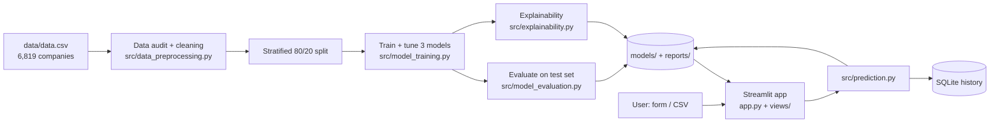
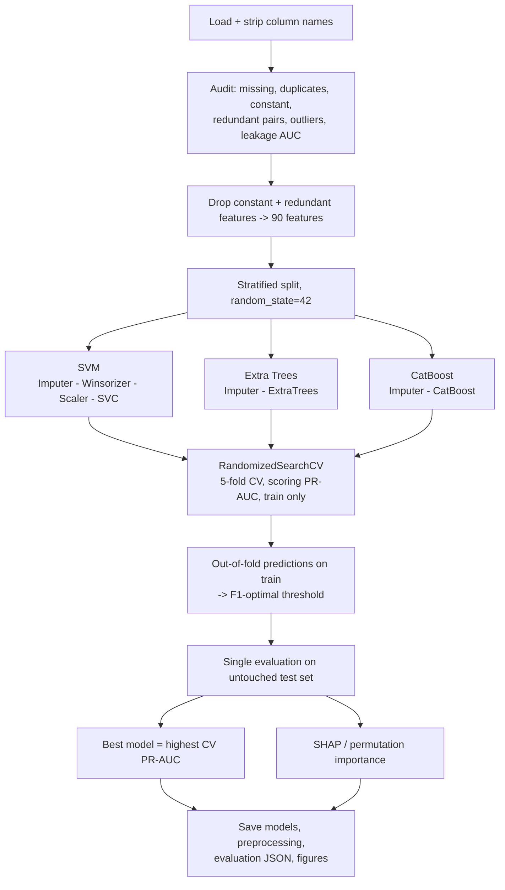
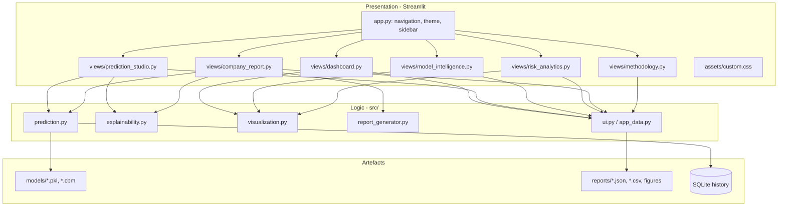
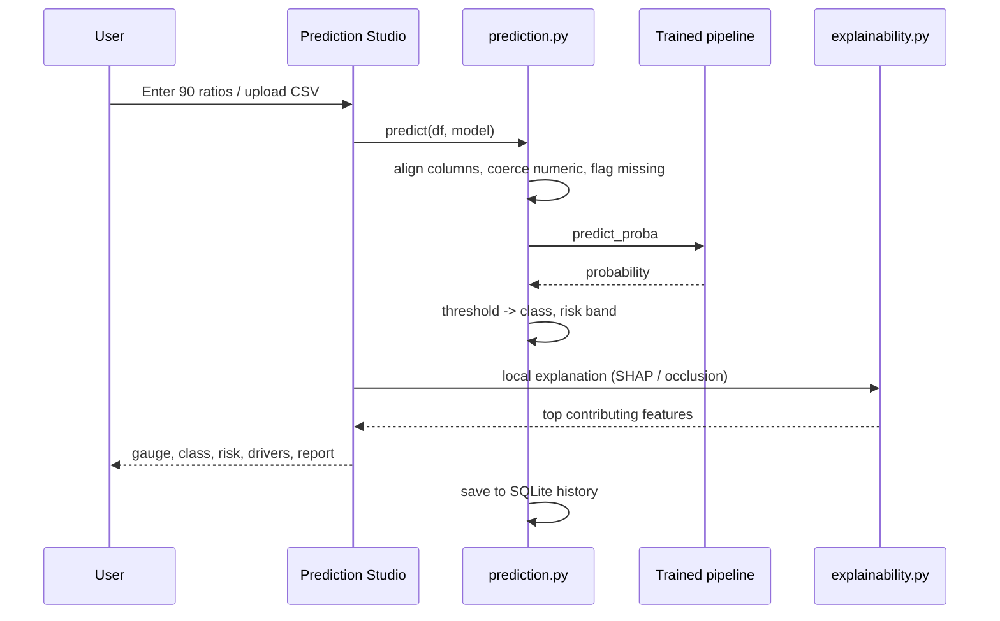

# FinGuard AI - System Architecture

## 1. High-level overview

## 2. Training pipeline (`python train.py`)

## 3. Application layers

## 4. Prediction flow (one company)

## 5. Design decisions
| Decision | Reason |
|---|---|
| Class weights, no SMOTE | 176 positives in 90 dimensions; synthetic data risky; SMOTE must be applied inside CV folds |
| PR-AUC for tuning/selection | 3.2% positive class; accuracy and ROC-AUC are optimistic |
| Threshold from out-of-fold training predictions | Test set never influences any choice |
| Winsorising for SVM only | Kernel models are outlier-sensitive; trees are invariant |
| `views/` instead of `pages/` | Streamlit auto-registers `pages/` and overrides custom navigation |
| Risk bands relative to model threshold | Probabilities are class-weighted; bands are a project convention, not an industry standard |
